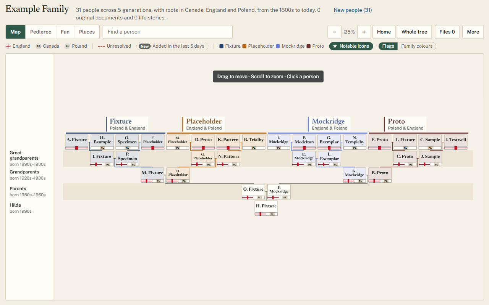
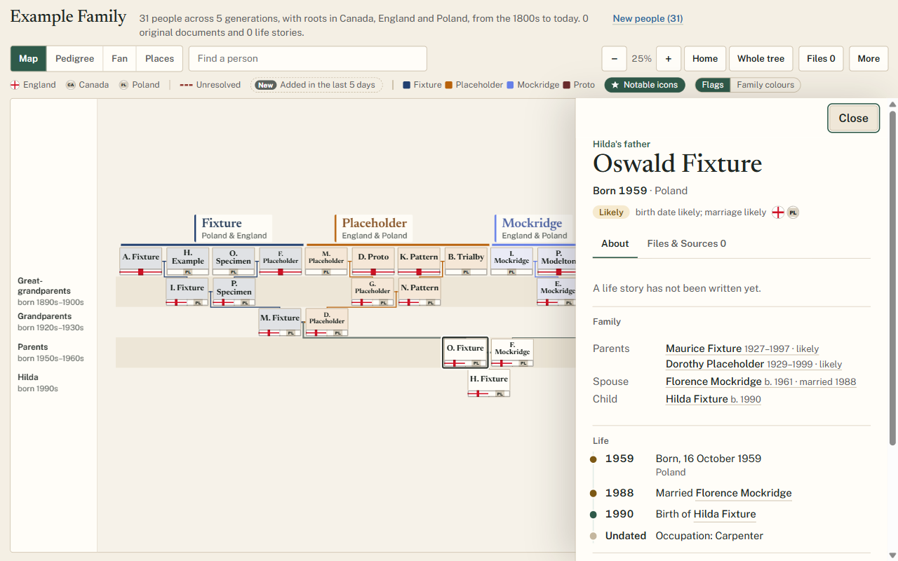
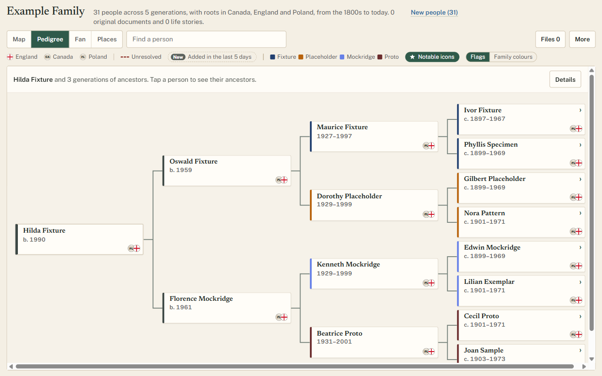
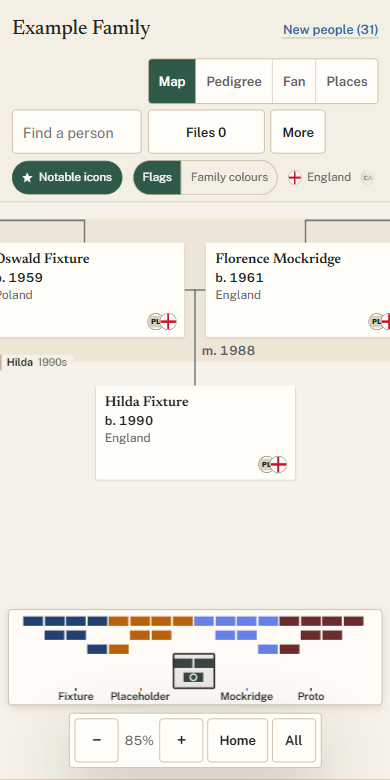

# family-history-engine

An evidence-first genealogy research harness for AI coding agents (Claude Code, Codex). It keeps a family tree as a canonical store of sourced assertions, schedules research questions, drives provider searches and record acquisition, records every search so it is never repeated blindly, and publishes a protected, passphrase-gated tree viewer.

Every fact is an assertion with an assessment (established, candidate, unresolved, rejected), a conclusion and its evidence. A parent link needs an archived original with an independent review before it counts.

## What it looks like

Every screenshot is the sample tree from `tools/fixtures/fixture-tree.ged`: invented people, five generations.



Each person's page keeps facts and their evidence status apart. Everything imported from a GEDCOM is a candidate ("Likely") until an original record confirms it.



| Pedigree chart | On a phone |
| --- | --- |
|  |  |

## Try it in five minutes

```sh
git clone https://github.com/zpalmtree/family-history-engine.git
cd family-history-engine && npm ci
node tools/tree-init.mjs --dir ../sample-family --id sample-family --title "Sample Family" --gedcom tools/fixtures/fixture-tree.ged
cd ../sample-family && npm ci && npm run build
node tools/check-new-tree.mjs        # ten checks, all should pass
npx --yes serve .                    # then open the address it prints, at /index.html
```

Swap the fixture for your own GEDCOM to see your family. `npm run research:session:status` then shows the first research question the agent would take: checking an imported parent link against an original record.

## Start a tree

```sh
node tools/tree-init.mjs --dir ../my-family --id my-family --title "My Family" --gedcom my-family.ged
cd ../my-family
npm install
npm run build
node tools/check-new-tree.mjs
```

A GEDCOM import comes in as research leads: every imported fact is a candidate, and each imported parent link opens a research question. See [TREE-SETUP.md](TREE-SETUP.md) for the configuration (`tree.config.json`), the consents file (`consents.json`) and exporting back to GEDCOM.

## Requirements

- Node.js 22 or later.
- Google Chrome or Chromium. On macOS and Linux, `npm run browser:start` opens a Chrome with the tree's own profile and `npm run local -- tools/<tool>.mjs` runs a research tool against it. On Windows the tools use the shared-browser bridge and the PowerShell wrappers. See [TREE-SETUP.md](TREE-SETUP.md#platforms) for what still needs Windows.
- A Vercel project and Blob store of your own for the protected viewer.
- An AI coding agent plan of your own. Long research sessions use a lot of it.

## Before you use the provider automation

The engine automates searches and record acquisition on Ancestry, Findmypast, FamilySearch, the GRO, The National Archives, Archion and other providers in your own signed-in browser. Automated access may breach a provider's terms of use, and the risk is yours. Use only subscriptions you hold, keep records acquired under them private, and never redistribute them.

Helpers that act as you (card payments, bank transfers through Wise, email enquiries, contact forms, saved sign-ins, account registration, mailbox reading) are all switched off until you enable them in `consents.json`. Payments still need your exact `PAY <request-id>` confirmation each time, stay within the approved amount, and leave card security codes, MFA, CAPTCHAs and the final bank-transfer send to you.

## Privacy

Self-host only. Your tree repository holds living people's details and records acquired under your subscriptions: keep it private. This engine repository contains no family data.

## Licence

MIT. See [LICENSE](LICENSE).
